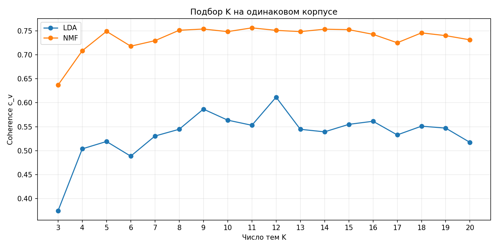
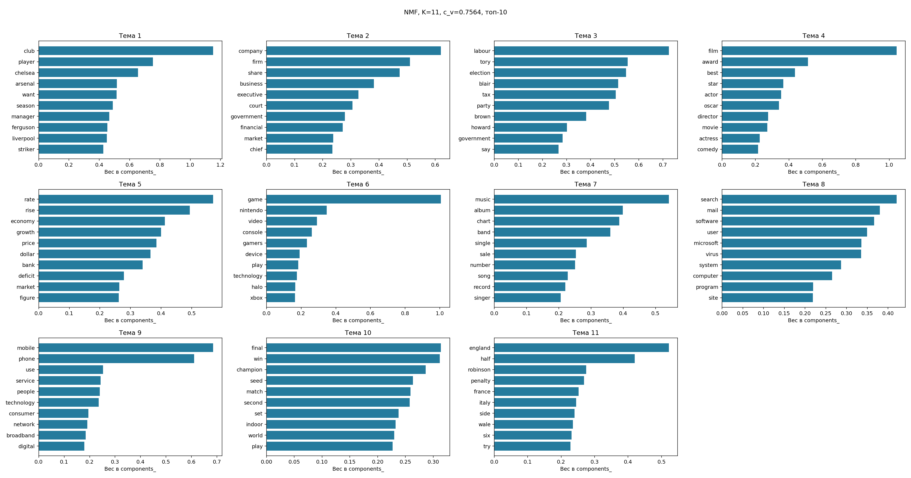
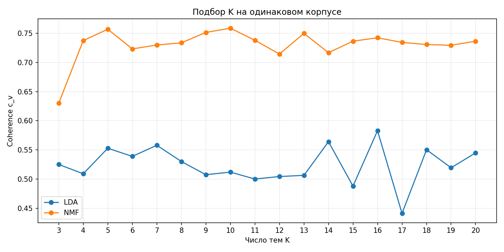
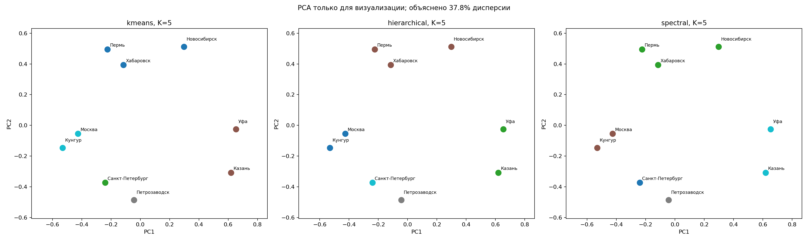
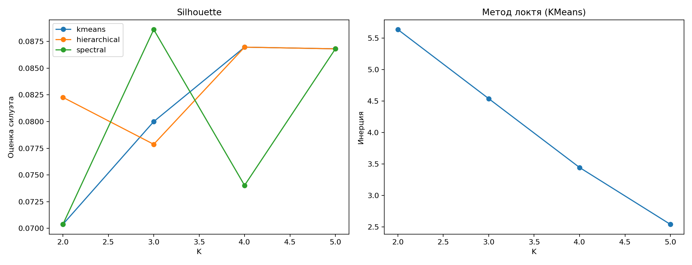

# Лабораторная работа №5 (практика 3)

## Цель и данные

Реализовать воспроизводимый анализ веб-текстов: очистка, NLP, векторизация, LDA/NMF, выбор числа тем по coherence. Дополнительно представить города векторами частот блюд и сравнить три метода кластеризации.

BBC: 500 полнотекстовых статей разных категорий. Amazon: 234 уникальных товара категории Software с описанием 15–200 слов и одним реальным коротким отзывом 10–80 слов. Выборка задана кодом, seed=42. Категории не использовались как признаки. Отбор коротких отзывов ограничивает репрезентативность; тексты не генерировались и не обрезались.

## Методика

1. ftfy исправляет повреждённую кодировку; HTML, скрипты, URL и лишние пробелы удаляются. Текст приводится к нижнему регистру.
2. Дедупликация выполняется по ID, URL, очищенному телу и последовательности токенов. Новости без тела, товары без описания или отзыва отбрасываются.
3. Токенизация регулярным выражением, стоп-слова NLTK, английская лемматизация WordNet с POS-разметкой. Для пользовательского русского корпуса предусмотрен pymorphy3.
4. Общий словарь до 1000 признаков, min_df=2, max_df=0.95. LDA обучается на CountVectorizer; NMF — на TF-IDF с тем же словарём. Нулевые векторы не передаются модели.
5. LDA: sklearn, batch, 15 проходов. NMF: Frobenius, nndsvda, максимум 1000 итераций. Seed=42, один вычислительный поток.
6. Для каждого K=3…20 вычисляется Gensim CoherenceModel c_v: одинаковые тексты, top-10, окно 110. Максимум выбирается отдельно для каждого метода. В mixed показан фиксированный K=10.
7. Сохраняются темы с весами, документы-примеры, матрицы документ–тема, c_v, PNG и дополнительная визуализация pyLDAvis.

## Качество данных

| Корпус | До очистки | После | Среднее токенов | Медиана токенов |
|---|---:|---:|---:|---:|
| news | 500 | 495 | 205.5 | 180.0 |
| products | 234 | 234 | 81.3 | 80.0 |
| mixed | 734 | 729 | 165.6 | 138.0 |

У новостей удалены 4 совпадения очищенного содержимого и 1 совпадение токенизированных текстов. В товарной выборке повторов после основного отбора не обнаружено. Обе выборки содержат более 200 пригодных документов.

## Результаты LDA и NMF

| Корпус | Метод | Выбранное K | c_v | Обучение выбранной модели, с |
|---|---|---:|---:|---:|
| news | LDA | 12 | 0.6117 | 1.714 |
| news | NMF | 11 | 0.7564 | 0.046 |
| products | LDA | 16 | 0.5829 | 0.560 |
| products | NMF | 10 | 0.7588 | 0.022 |
| mixed | LDA | 10 | 0.5012 | 2.584 |
| mixed | NMF | 10 | 0.7056 | 0.134 |

Время в таблице относится только к обучению выбранной модели; оно не включает NLP, вычисление coherence, другие K и экспорт рисунков.

### news

Выше c_v в этом опыте у **NMF**. [Все темы, слова, примеры и сравнение](results/news_report.md).

**Примеры тем LDA:**

- Тема 9: labour, election, tax, tory, party, say, howard; c_v=0.807. Пример документа: «Howard and Blair tax pledge clash».
- Тема 11: search, user, software, use, mail, system, computer; c_v=0.789. Пример документа: «Search wars hit desktop PCs».
- Тема 12: blair, minister, tell, say, government, brown, prime; c_v=0.745. Пример документа: «Goldsmith: 'I was not leant on'».

**Примеры тем NMF:**

- Тема 4: film, award, best, star, actor, oscar, director; c_v=0.858. Пример документа: «Sideways dominates Spirit awards».
- Тема 3: labour, tory, election, blair, tax, party, brown; c_v=0.841. Пример документа: «Kennedy begins pre-election tour».
- Тема 5: rate, rise, economy, growth, price, dollar, bank; c_v=0.796. Пример документа: «US trade gap ballooned in October».

### products

Выше c_v в этом опыте у **NMF**. [Все темы, слова, примеры и сравнение](results/products_report.md).

**Примеры тем LDA:**

- Тема 15: digital, medium, music, capture, burn, video, new; c_v=0.879. Пример документа: «Toast 11 Titanium Mac [Old Version]».
- Тема 6: window, requirement, system, processor, hard, free, video; c_v=0.823. Пример документа: «Nero Burn Express 3».
- Тема 4: device, trend, micro, security, online, mac, family; c_v=0.700. Пример документа: «Trend Micro Maximum Security 2015 - 3 Devices  [OLD VERSION]».

**Примеры тем NMF:**

- Тема 9: tax, large, view, situation, step, bonus, refund; c_v=0.875. Пример документа: «H&R Block 2015 Premium + State Tax Software +  Refund Bonus Offer - Windows Download [Old Version]».
- Тема 4: office, microsoft, build, document, word, excel, team; c_v=0.874. Пример документа: «Microsoft Office Home and Student 2016 English».
- Тема 6: mcafee, every, online, security, surf, shop, digital; c_v=0.844. Пример документа: «McAfee Total Protection 2012--3 Users [Old Version]».

## Интерпретация и ограничения

Топ-слова и документы-примеры показывают, какие подмножества корпуса обнаружены моделью. Автоматическое название темы составлено из трёх ведущих слов и требует содержательной проверки. В BBC темы дробят пять исходных редакционных категорий на более узкие сюжеты; оптимальный по c_v K не обязан равняться числу категорий.

В товарах обнаруживаются редактирование видео/фото, офисные приложения, резервное копирование, бухгалтерия и подготовка налоговых деклараций. При этом несколько тем NMF различают именно бренды антивирусов: Norton, McAfee, Kaspersky, Trend Micro. Налоговые программы также разделились на TurboTax и H&R Block. Значит, высокий c_v частично объясняется повторяющейся рекламной лексикой и брендами, а не только функциональными категориями. Это содержательное ограничение результата. Поскольку использована только категория Software, вывод нельзя переносить на весь ассортимент электронной торговли.

На новостях LDA получила c_v=0.6117, на коротких товарных текстах — 0.5829. У NMF значения близки: 0.7564 и 0.7588 соответственно. Следовательно, ожидаемое ухудшение на коротких текстах в этом опыте наблюдается у LDA, но не подтверждается у NMF. Победа LDA на новостях из примера лекции также не воспроизвелась: обе выборки дали более высокий c_v у NMF.

Сравнение длинных и коротких текстов имеет ограничения: различаются не только длины, но и домен, размер и период корпуса. Разность c_v не доказывает причинное влияние длины текста. Более высокий c_v — оценка совместной встречаемости слов, а не процент правильных ответов.

Число тем подобрано на том же корпусе, где измеряется c_v; отдельного отложенного набора здесь нет. Возможны оптимистичная оценка и зависимость от seed. Это исследовательское сравнение, а не подтверждение качества на будущих данных. Веса NMF нормированы по строкам для визуализации, но не являются апостериорными вероятностями LDA.

## Кластеризация городов

Исследовано 9 городов. Успешно извлечено 24 страниц из 28; проблемные страницы зарегистрированы в журнале. Для каждого города осталось минимум два независимых домена. Размер словаря по фактическим упоминаниям — 48 блюд.

Изначальный список URL выбран поиском по названиям городов и кухне. Парсер автоматически находит названия блюд по словарю с вариантами написания (например, посикунчики/посекунчики, шаньги/шанежки). Общие слова «суп» и «салат» не являются признаками.

`frequency(city, dish) = число независимых сайтов города с упоминанием блюда / число успешно обработанных независимых сайтов города`

Частоты лежат в [0,1]. Перед кластеризацией применены IDF для снижения веса повсеместных блюд и L2-нормализация. Использованы KMeans, Ward и спектральная кластеризация с косинусной матрицей сходства. Для K=2…5 посчитан silhouette, для KMeans также inertia; общий K выбран по среднему silhouette трёх методов.

Выбрано K=5. ARI: kmeans / hierarchical: 1.000; kmeans / spectral: 1.000; hierarchical / spectral: 1.000.

- Новосибирск, Пермь, Хабаровск: строганина, пельмени, уха, шаньги, посику́нчики, папоротник.
- Санкт-Петербург: шаверма, корюшка, пышки, тартар, пельмени, блины.
- Казань, Уфа: эчпочмак, чак-чак, кыстыбый, манты, казы, бэлеш.
- Петрозаводск: калитки, ряпушка, уха, лохикейтто.
- Кунгур, Москва: оливье, солянка, расстегай, щи, калач, роллы.

**Проверка гипотез:** Казань и Уфа оказались вместе во всех трёх методах. Пермь и Кунгур — раздельно. В источниках Кунгура преобладают меню смешанной кухни; по этой выборке город нельзя уверенно отнести к пермской кулинарной традиции. Результат не подгонялся под ожидаемую пару. Совпадение методов не устраняет смещение источников.

Сочетание ресторанных меню с региональными обзорами и всего 2–3 сайта на город ограничивает выводы. Для серьёзного исследования нужны более равномерный набор источников, ручная проверка контекста упоминаний, более широкий словарь и проверка устойчивости при изменении выборки. PCA служит только для рисунка; кластеризация проведена в полном пространстве.

[Полный отчёт с источниками](results/cities/city_report.md).

## Проверка и воспроизводимость

Работа выполняется командой `python run_all.py` из установленного окружения. Пакеты закреплены в requirements-lock.txt; данные и NLP-словари приложены. Сеть при повторном анализе не нужна. Параметры, версии и SHA-256 кода/входов записаны в summary.json.

18 тестов проверяют очистку, обе лемматизации, дедупликацию, схему JSON/CSV, неверные параметры CLI, недобор, частоты по независимым доменам и retry на локальном HTTP-сервере. Дополнительно verify_results.py проверяет реальные результаты полного прогона: все K, максимум c_v, количество документов, согласованность идентификаторов и сумму долей по строкам.

[Результаты тестов](results/tests.txt) · [Проверка артефактов](results/verification.txt) · [Инструкция](README.md)

## Источники методики и корпусов

- [BBC corpus / UCD](http://mlg.ucd.ie/datasets/bbc.html).
- [Amazon Reviews 2018 / UCSD](https://cseweb.ucsd.edu/~jmcauley/datasets/amazon_v2/).
- [Gensim CoherenceModel](https://radimrehurek.com/gensim/models/coherencemodel.html).
- [scikit-learn: LDA и NMF](https://scikit-learn.org/stable/auto_examples/applications/plot_topics_extraction_with_nmf_lda.html).
- URL, хеши архивов и правило отбора: [data/sources.json](data/sources.json).
