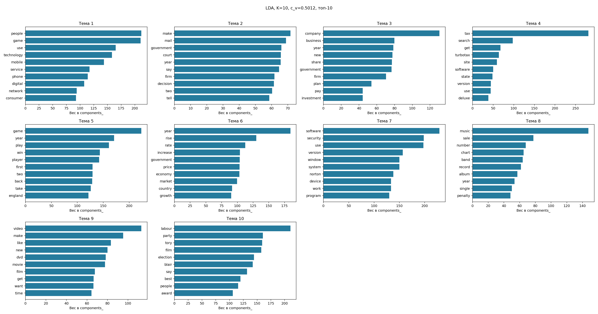
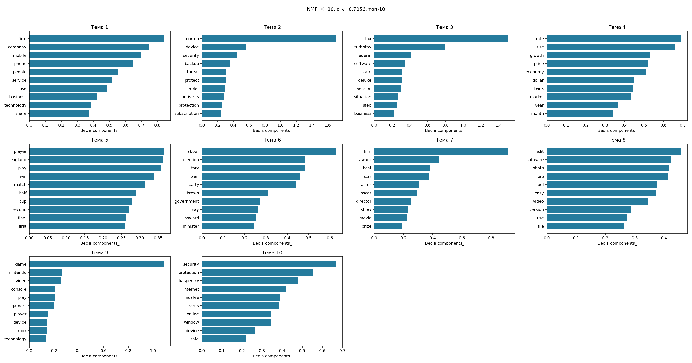

# Тематическое моделирование: mixed

Документов: 729; словарь: 1000; seed=42.

| Метод | K | c_v | Обучение, с |
|---|---:|---:|---:|
| LDA | 10 | 0.5012 | 2.58 |
| NMF | 10 | 0.7056 | 0.13 |

K выбран по максимуму c_v на том же корпусе. Это описательная оценка, не качество на новых данных.
LDA использует CountVectorizer, NMF — TF-IDF с тем же словарём. Веса NMF нормированы по строкам и не являются вероятностями LDA.
Слова в label — автоматические подсказки для интерпретации, не экспертные категории.

На этом запуске выше c_v у **NMF**. Вывод относится только к данному корпусу и настройкам.

| Тема | LDA: ключевые слова | NMF: ключевые слова |
|---:|---|---|
| 1 | people, game, use, technology, mobile | firm, company, mobile, phone, people |
| 2 | make, mail, government, court, year | norton, device, security, backup, threat |
| 3 | company, business, year, new, share | tax, turbotax, federal, software, state |
| 4 | tax, search, get, turbotax, site | rate, rise, growth, price, economy |
| 5 | game, year, play, win, player | player, england, play, win, match |
| 6 | year, rise, rate, increase, government | labour, election, tory, blair, party |
| 7 | software, security, use, version, window | film, award, best, star, actor |
| 8 | music, sale, number, chart, band | edit, software, photo, pro, tool |
| 9 | video, make, like, new, dvd | game, nintendo, video, console, play |
| 10 | labour, party, tory, film, election | security, protection, kaspersky, internet, mcafee |

Номера тем разных моделей не выровнены: строка таблицы не означает соответствие тем.

## LDA

- Тема 1 (0.635): people / game / use. Пример: Lifestyle 'governs mobile choice'.
- Тема 2 (0.310): make / mail / government. Пример: Executive trio leave Aer Lingus.
- Тема 3 (0.486): company / business / year. Пример: BAA support ahead of court battle.
- Тема 4 (0.418): tax / search / get. Пример: TurboTax Home &amp; Business 2014 Fed + State + Fed Efile Tax Software - Win [Download] OLD VERSION.
- Тема 5 (0.488): game / year / play. Пример: Nadal puts Spain 2-0 up.
- Тема 6 (0.625): year / rise / rate. Пример: Bank holds interest rate at 4.75%.
- Тема 7 (0.722): software / security / use. Пример: Genie Backup Manager Professional V8.0.
- Тема 8 (0.573): music / sale / number. Пример: Downloads enter US singles chart.
- Тема 9 (0.410): video / make / like. Пример: Pinnacle Studio 18 Ultimate (Old Version).
- Тема 10 (0.345): labour / party / tory. Пример: Triple triumph for Little Britain.

## NMF

- Тема 1 (0.552): firm / company / mobile. Пример: Home phones face unclear future.
- Тема 2 (0.773): norton / device / security. Пример: Norton Security Deluxe &ndash; 3 Devices &ndash; 1 Year Subscription &ndash; Product Key Card - 2019 Ready.
- Тема 3 (0.540): tax / turbotax / federal. Пример: Intuit TurboTax Premier 2015 Federal + State Taxes + Fed Efile Tax Preparation Software - PC/MacDisc [Old Version].
- Тема 4 (0.736): rate / rise / growth. Пример: House prices show slight increase.
- Тема 5 (0.702): player / england / play. Пример: Wilkinson to lead England.
- Тема 6 (0.842): labour / election / tory. Пример: Blair to face MPs amid feud talk.
- Тема 7 (0.772): film / award / best. Пример: Aviator wins top Globes accolades.
- Тема 8 (0.716): edit / software / photo. Пример: Corel PaintShop Pro X8 Ultimate [Old Version].
- Тема 9 (0.767): game / nintendo / video. Пример: Nintendo DS makes its Euro debut.
- Тема 10 (0.655): security / protection / kaspersky. Пример: Kaspersky Internet Security 1 -2015.

