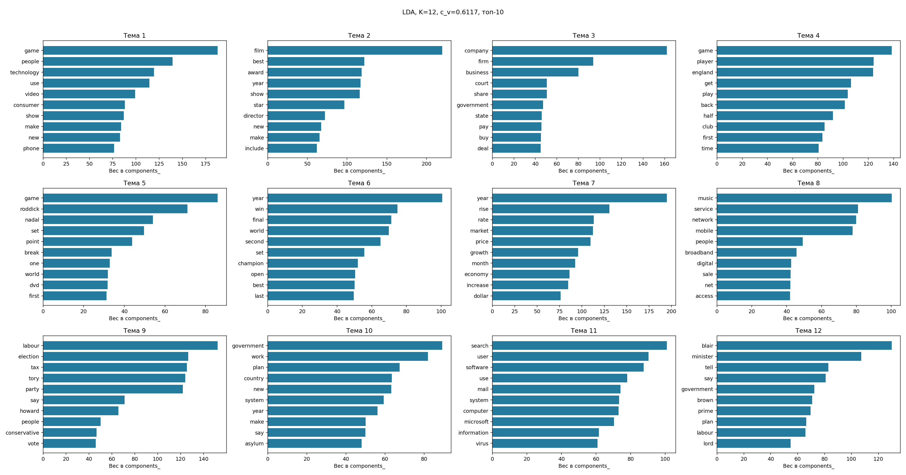

# Тематическое моделирование: news

Документов: 495; словарь: 1000; seed=42.

| Метод | K | c_v | Обучение, с |
|---|---:|---:|---:|
| LDA | 12 | 0.6117 | 1.71 |
| NMF | 11 | 0.7564 | 0.05 |

K выбран по максимуму c_v на том же корпусе. Это описательная оценка, не качество на новых данных.
LDA использует CountVectorizer, NMF — TF-IDF с тем же словарём. Веса NMF нормированы по строкам и не являются вероятностями LDA.
Слова в label — автоматические подсказки для интерпретации, не экспертные категории.

На этом запуске выше c_v у **NMF**. Вывод относится только к данному корпусу и настройкам.

| Тема | LDA: ключевые слова | NMF: ключевые слова |
|---:|---|---|
| 1 | game, people, technology, use, video | club, player, chelsea, arsenal, want |
| 2 | film, best, award, year, show | company, firm, share, business, executive |
| 3 | company, firm, business, court, share | labour, tory, election, blair, tax |
| 4 | game, player, england, get, play | film, award, best, star, actor |
| 5 | game, roddick, nadal, set, point | rate, rise, economy, growth, price |
| 6 | year, win, final, world, second | game, nintendo, video, console, gamers |
| 7 | year, rise, rate, market, price | music, album, chart, band, single |
| 8 | music, service, network, mobile, people | search, mail, software, user, microsoft |
| 9 | labour, election, tax, tory, party | mobile, phone, use, service, people |
| 10 | government, work, plan, country, new | final, win, champion, seed, match |
| 11 | search, user, software, use, mail | england, half, robinson, penalty, france |
| 12 | blair, minister, tell, say, government | — |

Номера тем разных моделей не выровнены: строка таблицы не означает соответствие тем.

## LDA

- Тема 1 (0.508): game / people / technology. Пример: Media gadgets get moving.
- Тема 2 (0.509): film / best / award. Пример: Triple triumph for Little Britain.
- Тема 3 (0.548): company / firm / business. Пример: Japanese mogul arrested for fraud.
- Тема 4 (0.566): game / player / england. Пример: England 17-18 France.
- Тема 5 (0.475): game / roddick / nadal. Пример: Nadal puts Spain 2-0 up.
- Тема 6 (0.598): year / win / final. Пример: Holmes back on form in Birmingham.
- Тема 7 (0.718): year / rise / rate. Пример: 'Strong dollar' call halts slide.
- Тема 8 (0.641): music / service / network. Пример: Musicians 'upbeat' about the net.
- Тема 9 (0.807): labour / election / tax. Пример: Howard and Blair tax pledge clash.
- Тема 10 (0.436): government / work / plan. Пример: CSA chief who 'quit' still in job.
- Тема 11 (0.789): search / user / software. Пример: Search wars hit desktop PCs.
- Тема 12 (0.745): blair / minister / tell. Пример: Goldsmith: 'I was not leant on'.

## NMF

- Тема 1 (0.733): club / player / chelsea. Пример: Anelka apologises for criticism.
- Тема 2 (0.587): company / firm / share. Пример: HealthSouth ex-boss goes on trial.
- Тема 3 (0.841): labour / tory / election. Пример: Kennedy begins pre-election tour.
- Тема 4 (0.858): film / award / best. Пример: Sideways dominates Spirit awards.
- Тема 5 (0.796): rate / rise / economy. Пример: US trade gap ballooned in October.
- Тема 6 (0.743): game / nintendo / video. Пример: Game warnings 'must be clearer'.
- Тема 7 (0.774): music / album / chart. Пример: 'Christmas song formula' unveiled.
- Тема 8 (0.777): search / mail / software. Пример: Microsoft seeking spyware trojan.
- Тема 9 (0.726): mobile / phone / use. Пример: Moving mobile improves golf swing.
- Тема 10 (0.755): final / win / champion. Пример: Merritt close to indoor 400m mark.
- Тема 11 (0.730): england / half / robinson. Пример: Scotland 18-10 Italy.

