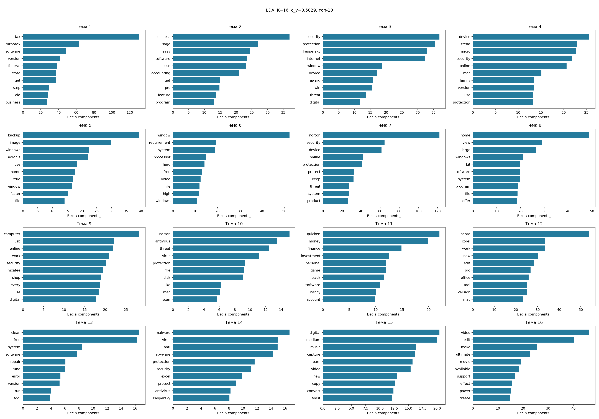
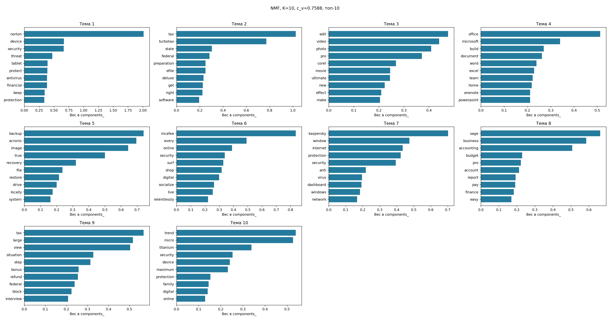

# Тематическое моделирование: products

Документов: 234; словарь: 1000; seed=42.

| Метод | K | c_v | Обучение, с |
|---|---:|---:|---:|
| LDA | 16 | 0.5829 | 0.56 |
| NMF | 10 | 0.7588 | 0.02 |

K выбран по максимуму c_v на том же корпусе. Это описательная оценка, не качество на новых данных.
LDA использует CountVectorizer, NMF — TF-IDF с тем же словарём. Веса NMF нормированы по строкам и не являются вероятностями LDA.
Слова в label — автоматические подсказки для интерпретации, не экспертные категории.

На этом запуске выше c_v у **NMF**. Вывод относится только к данному корпусу и настройкам.

| Тема | LDA: ключевые слова | NMF: ключевые слова |
|---:|---|---|
| 1 | tax, turbotax, software, version, federal | norton, device, security, threat, tablet |
| 2 | business, sage, easy, software, use | tax, turbotax, state, federal, preparation |
| 3 | security, protection, kaspersky, internet, window | edit, video, photo, pro, corel |
| 4 | device, trend, micro, security, online | office, microsoft, build, document, word |
| 5 | backup, image, windows, acronis, use | backup, acronis, image, true, recovery |
| 6 | window, requirement, system, processor, hard | mcafee, every, online, security, surf |
| 7 | norton, security, device, online, protection | kaspersky, window, internet, protection, security |
| 8 | home, view, large, windows, bit | sage, business, accounting, budget, pro |
| 9 | computer, usb, online, work, security | tax, large, view, situation, step |
| 10 | norton, antivirus, threat, virus, protection | trend, micro, titanium, security, device |
| 11 | quicken, money, finance, investment, personal | — |
| 12 | photo, corel, work, new, edit | — |
| 13 | clean, free, system, software, repair | — |
| 14 | malware, virus, anti, spyware, protection | — |
| 15 | digital, medium, music, capture, burn | — |
| 16 | video, edit, make, ultimate, movie | — |

Номера тем разных моделей не выровнены: строка таблицы не означает соответствие тем.

## LDA

- Тема 1 (0.690): tax / turbotax / software. Пример: TurboTax Home &amp; Business 2014 Fed + State + Fed Efile Tax Software - Win [Download] OLD VERSION.
- Тема 2 (0.437): business / sage / easy. Пример: Fix-It Utilities 12 Professional [Old Version].
- Тема 3 (0.656): security / protection / kaspersky. Пример: 360 internet security [Download].
- Тема 4 (0.700): device / trend / micro. Пример: Trend Micro Maximum Security 2015 - 3 Devices  [OLD VERSION].
- Тема 5 (0.540): backup / image / windows. Пример: Microsoft Windows 10 Home | Download.
- Тема 6 (0.823): window / requirement / system. Пример: Nero Burn Express 3.
- Тема 7 (0.654): norton / security / device. Пример: Norton Internet Security 2009 [OLD VERSION].
- Тема 8 (0.253): home / view / large. Пример: Hallmark Half-Fold Glossy Premium Photo Greeting Cards - 15 count.
- Тема 9 (0.439): computer / usb / online. Пример: Iogear POWERLINE/HOMEPLUG WALL MOUNT (GHPU21).
- Тема 10 (0.609): norton / antivirus / threat. Пример: Norton AntiVirus 11.0 For Mac.
- Тема 11 (0.444): quicken / money / finance. Пример: Microsoft Money 2003 Deluxe [OLD VERSION].
- Тема 12 (0.436): photo / corel / work. Пример: Corel AfterShot Pro 3 Photo Editing Software for PC/Mac (Key Card).
- Тема 13 (0.629): clean / free / system. Пример: System Mechanic - Up to 3 PCs.
- Тема 14 (0.645): malware / virus / anti. Пример: Kaspersky Anti-Virus 2012 - 3 PCs [Old Version].
- Тема 15 (0.879): digital / medium / music. Пример: Toast 11 Titanium Mac [Old Version].
- Тема 16 (0.492): video / edit / make. Пример: MAGIX Movie Edit Pro 2016 Plus.

## NMF

- Тема 1 (0.705): norton / device / security. Пример: Norton Security Deluxe &ndash; 3 Devices &ndash; 1 Year Subscription &ndash; Product Key Card - 2019 Ready.
- Тема 2 (0.823): tax / turbotax / state. Пример: TurboTax Deluxe 2015 Federal + State Taxes + Fed Efile Tax Preparation Software - Mac Download [Old Version].
- Тема 3 (0.720): edit / video / photo. Пример: Corel PaintShop Pro X7 Ultimate (Old Version).
- Тема 4 (0.874): office / microsoft / build. Пример: Microsoft Office Home and Student 2016 English.
- Тема 5 (0.750): backup / acronis / image. Пример: Acronis True Image Backup &amp; Recovery 2014.
- Тема 6 (0.844): mcafee / every / online. Пример: McAfee Total Protection 2012--3 Users [Old Version].
- Тема 7 (0.603): kaspersky / window / internet. Пример: Kaspersky Internet Security 1 -2015.
- Тема 8 (0.620): sage / business / accounting. Пример: Sage 50 Pro Accounting 2016.
- Тема 9 (0.875): tax / large / view. Пример: H&amp;R Block 2015 Premium + State Tax Software +  Refund Bonus Offer - Windows Download [Old Version].
- Тема 10 (0.773): trend / micro / titanium. Пример: Trend MicroTrend Micro Titanium Maximum Premium 2014 [Old Version].

